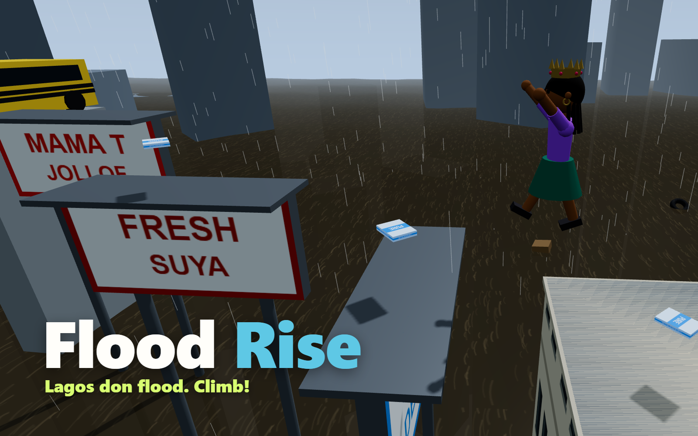

# Flood Rise

**Lagos don flood!** The water keeps rising. Jump across rooftops, danfos, water tanks and billboards, grab pure water sachets, and climb as high as you can before the flood catches you.

A three.js game for [start.ng](https://start.ng). Play it at **https://flood-rise.start.ng**.



## Your start.ng character

Flood Rise asks start.ng who's playing (`startng:whoami` through the hidden `https://start.ng/connect` page) and builds the 3D character from your start.ng `style`:

| start.ng style | In the game |
|---|---|
| `body` | `female`: skirt and slimmer build; `male`: trousers and broader shoulders |
| `primaryColor` | top and sleeves (and the beanie) |
| `secondaryColor` | trousers or skirt (and the cap, scarf and backpack) |
| `skinColor` | face, neck, arms, hands and legs |
| `hairColor` | hair and beard |
| `hair` | `short`, `afro`, `braids`, `bun`, `ponytail`, `dreads`, `bald` |
| `hat` | `none`, `cap`, `beanie`, `tophat`, `crown` |
| `accessory` | `none`, `glasses`, `earrings`, `beard`, `scarf`, `backpack` |

Change your character on start.ng, come back to the tab, and your in-game character changes too. Guests play as start.ng's guest look and can sign in from the profile card.

## Leaderboard

`startng.json` declares two columns: **Height (m)**, then **Pure water sachets** as the tie-break. Signed-in players' runs are saved with `startng:score`, and the board is read with `startng:leaderboard`.

## Controls

- **W A S D** or arrow keys: run
- **Space**: jump (hold for a higher jump)
- **Drag**, or **Q** / **E**: turn the camera; mouse wheel zooms
- **P** or **Esc**: pause, **M**: sound on or off
- Phones: joystick on the left, jump button on the right, drag on the right to turn

## Run it locally

It's a static site with no build step. three.js r170 is vendored in `vendor/`.

```sh
python -m http.server 8000
# open http://localhost:8000
```

Locally there's no start.ng player, so you play as a guest. To try a look, add `?style={"hair":"afro","hat":"crown",...}` to the address (ignored on start.ng). `tools/styles.html` shows every hair, hat and accessory side by side.

## Files

- `src/main.js`: game loop, controls, physics, rising water, HUD, start.ng sign-in and scores
- `src/character.js`: builds the character from a start.ng `style`
- `src/world.js`: the flooded city, platform generation, water, rain and lightning
- `src/startng.js`: talks to start.ng's connect page
- `src/sound.js`: synthesized sounds, so there are no audio files
